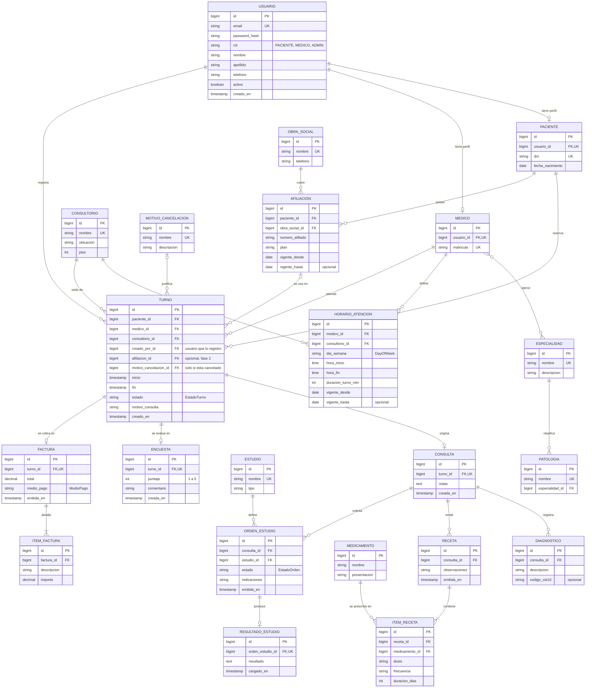
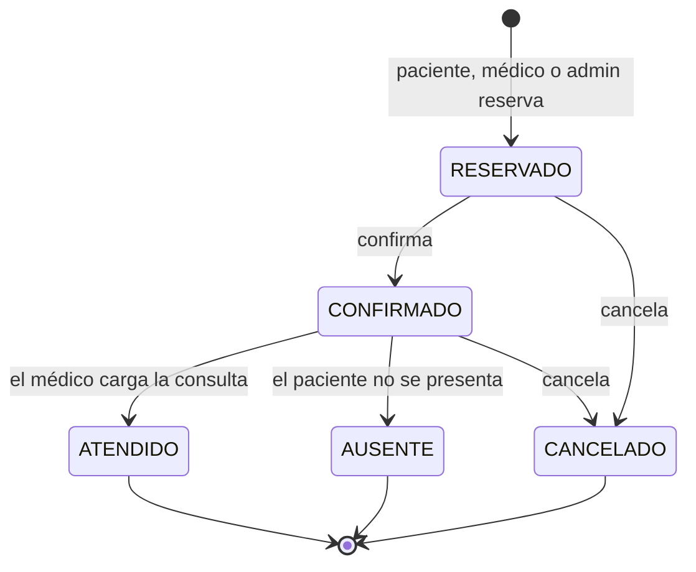

# Modelo de datos y reglas de negocio

Este documento fija el modelo antes de escribir código. Parte del dominio del
trabajo práctico original (turnos, médicos, pacientes, recetas...) pero
corrige lo que allí quedó sin resolver: relaciones reales entre tablas, tipos
de datos adecuados y reglas de negocio explícitas.

## Principios

- **Relaciones reales.** Toda referencia entre tablas es una clave foránea
  (`@ManyToOne` en JPA), no un `Long` suelto.
- **Tipos correctos.** Dinero en `decimal` (`BigDecimal`), fechas y horas con
  `LocalDate` / `LocalTime` / `LocalDateTime`, números de afiliado como texto
  (pueden tener ceros a la izquierda).
- **Enums para conjuntos cerrados** con lógica asociada (estado del turno, rol,
  medio de pago). **Tablas para catálogos** que el administrador edita
  (especialidades, consultorios, medicamentos).
- **Sin borrado físico** de registros con historia clínica: usuarios y médicos
  se desactivan (`activo = false`).
- **Nunca se exponen entidades**: la API trabaja con DTOs.
- **Datos de demostración ficticios.** El sistema maneja información de salud;
  el repositorio solo contiene datos inventados.
- Nombres de dominio en español (`Turno`, `Medico`); tablas en `snake_case`.

## Diagrama entidad-relación

`ADMIN` no tiene tabla propia: es un valor de `USUARIO.rol` y no guarda datos
específicos de su rol.

`PATOLOGIA` es un catálogo que edita el admin: cada síntoma/patología apunta a
una `ESPECIALIDAD`. Un paciente que no sabe a qué especialista ir elige "qué
le pasa" y el sistema le filtra los médicos de esa especialidad (ver regla 13).
Es solo una ayuda de navegación, no una restricción: el paciente igual puede
elegir cualquier médico directamente.

## Fases

| Fase | Estado | Alcance | Entidades |
|---|---|---|---|
| 1. Turnos | ✅ hecha | Login con roles, catálogos, agenda, derivación por patología y reserva de turnos | `Usuario`, `Paciente`, `Medico`, `Especialidad`, `Patologia`, `Consultorio`, `HorarioAtencion`, `Turno`, `MotivoCancelacion` |
| 2. Atención clínica | ✅ hecha | Consulta, diagnóstico, receta e historial | `Consulta`, `Diagnostico`, `Medicamento`, `Receta`, `ItemReceta` |
| 2b. Cobertura | ✅ hecha | Obra social y afiliación del paciente | `ObraSocial`, `Afiliacion` |
| 3. Complementos | pendiente | Estudios, encuestas, cobros y panel de métricas | `Estudio`, `OrdenEstudio`, `ResultadoEstudio`, `Encuesta`, `Factura`, `ItemFactura` |

La fase 2b agrega `ObraSocial` (catálogo que edita el admin) y `Afiliacion`
(cada paciente gestiona las propias: alta, listado y baja). `turno.afiliacion_id`
es opcional: al reservar, un paciente puede indicar con qué afiliación propia
se atiende ese turno concreto; si no indica ninguna, el turno queda sin
cobertura asociada ("particular"). La facturación (fase 3) es opcional y se
simplificará si el alcance se extiende demasiado.

## Estados del turno

`EstadoTurno` es un enum con transiciones controladas por el servicio, no una
tabla editable.

| Transición | Quién puede |
|---|---|
| Reservar | Paciente (para sí mismo); médico o admin, a nombre de un paciente (por DNI) |
| Confirmar | Paciente (el propio); médico (de su agenda); admin (cualquiera) |
| Cancelar | Paciente (con anticipación mínima); médico (de su agenda) y admin (cualquiera), sin esa restricción |
| Marcar ausente | Médico (de su agenda), admin |
| Atendido | Médico del turno, al cargar la consulta |

## Reglas de negocio

**Agenda y turnos**

1. Los turnos salen de la grilla del médico: el `inicio` debe caer dentro de un
   `HorarioAtencion` de ese día y alinearse con `duracion_turno_min`. Los
   horarios libres se calculan (horarios menos turnos activos); no se guardan.
2. Un médico no puede tener dos turnos activos (no cancelados) en el mismo
   horario. Se garantiza **en la base de datos** con un índice único parcial
   sobre `(medico_id, inicio)` donde `estado <> 'CANCELADO'`, además de la
   validación en el servicio, para que dos reservas simultáneas no puedan
   duplicar el turno.
3. Un paciente no puede tener dos turnos activos superpuestos.
4. No se reserva en el pasado ni más allá de una ventana configurable
   (por ejemplo, 60 días).
5. El paciente solo puede cancelar con una anticipación mínima configurable
   (por ejemplo, 2 horas). El médico (sus propios turnos) y el admin
   (cualquiera) pueden cancelar siempre, sin esa restricción. Toda
   cancelación exige un `MotivoCancelacion`.
6. Los horarios de un mismo médico no se pisan entre sí, y un consultorio no
   puede tener dos médicos en el mismo horario.
7. Un paciente puede elegir una `Patologia` al buscar turno; el sistema la
   traduce a su `Especialidad` y filtra los médicos que la ejercen. Es solo
   un filtro de ayuda: el paciente igual puede elegir cualquier médico
   directamente, sin pasar por una patología.

**Atención clínica**

8. La `Consulta` solo existe para turnos confirmados y es 1:1 con el turno.
   Crearla pasa el turno a `ATENDIDO`. Solo el médico del turno (o un admin)
   la carga; no se edita después. Una `Receta` cuelga de una Consulta ya
   cargada y la emite esa misma persona.
9. El historial del paciente **no es una tabla**: se calcula a partir de sus
   turnos `ATENDIDO` (vía la Consulta de cada uno) — no incluye estudios
   todavía, eso es fase 3.

**Acceso a los datos (mínimo privilegio)**

10. El **paciente** solo ve y gestiona sus propios turnos.
11. El **médico** ve el historial de los pacientes con los que tiene o tuvo
    turnos, y gestiona (reserva, confirma, cancela, marca ausente) los turnos
    de su propia agenda.
12. El **admin** gestiona usuarios, catálogos, y puede gestionar la agenda y
    los turnos de cualquier médico — las mismas acciones que tiene el médico
    sobre la suya.

## Cambios respecto al trabajo original

| Original | Acá |
|---|---|
| Todas las referencias como `Long` (`pacienteId`, `medicoId`...) | Claves foráneas reales con `@ManyToOne` |
| `EstadoTurno` como tabla con CRUD | Enum con máquina de estados |
| `Asistente` como entidad, con su propio CRUD | Eliminado: hacía lo mismo que `Admin`, que ya puede gestionar todo el sistema de turnos |
| `HistorialPaciente` como tabla de eventos | Se calcula desde consultas, recetas y estudios |
| `Medico.especialidad` como `String` | Relación N:M con `Especialidad` |
| `Turno` con `fecha` y `hora` separadas | `inicio` y `fin` como `LocalDateTime` |
| `Afiliacion`: `obraSocialId` como `String`, `numeroAfiliado` como `Long` | FK a `ObraSocial`; número como texto |
| `Factura.monto` como `Double` | `decimal` / `BigDecimal` |
| `HorarioAtencion` con horas como `String` | `LocalTime`, más consultorio y duración del turno |
| `ResultadoEstudio.fechaCarga` como `LocalTime` | `timestamp` |
| Entidades referenciadas pero inexistentes (`Consulta`, `Estudio`, `MedioPago`) | `Consulta` y `Estudio` como entidades; `MedioPago` como enum |
| Sin login, validaciones, DTOs ni tests | Spring Security con JWT, Bean Validation, DTOs y tests |

## Fuera de alcance por ahora

Bloqueos de agenda (vacaciones, licencias), recordatorios por mail, subida de
archivos de resultados, integraciones con sistemas de facturación oficiales.
