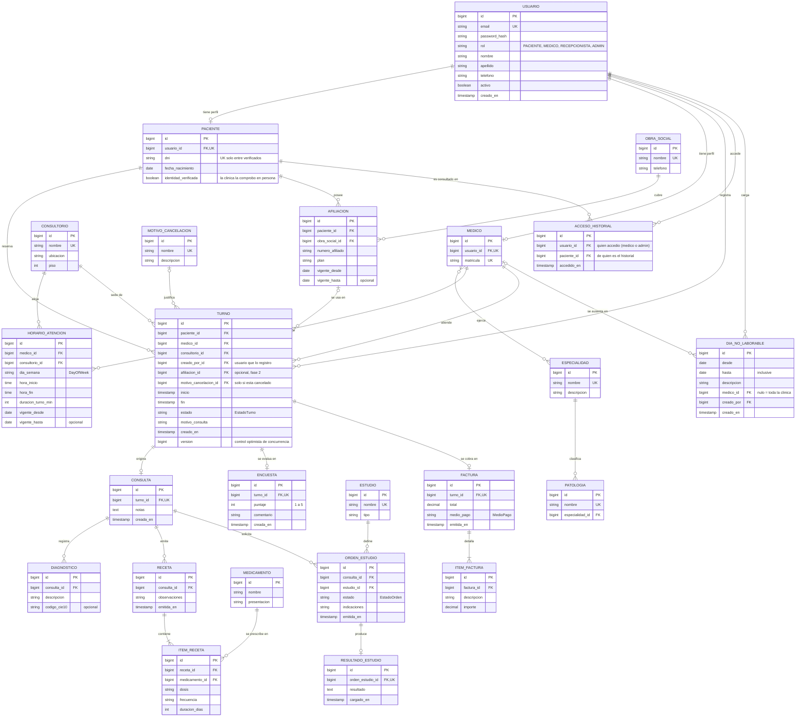
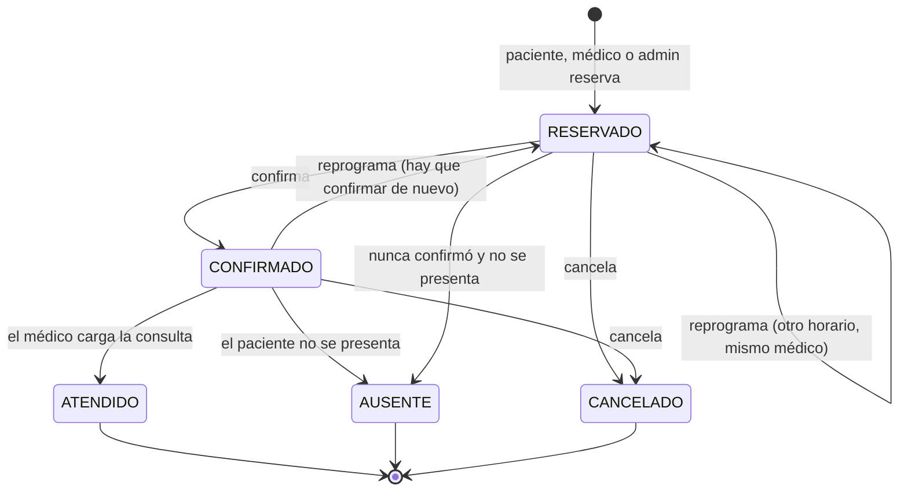

# Modelo de datos y reglas de negocio

Este documento fija el modelo antes de escribir código. Parte del dominio del
trabajo práctico original (turnos, médicos, pacientes, recetas...) pero
corrige lo que allí quedó sin resolver: relaciones reales entre tablas, tipos
de datos adecuados y reglas de negocio explícitas.

## Principios

- **Relaciones reales.** Toda referencia entre tablas es una clave foránea
  (`@ManyToOne` en JPA), no un `Long` suelto.
- **Tipos correctos.** Dinero en `decimal` (`BigDecimal`), fechas y horas con
  `LocalDate` / `LocalTime` / `LocalDateTime`, números de afiliado como texto
  (pueden tener ceros a la izquierda).
- **Enums para conjuntos cerrados** con lógica asociada (estado del turno, rol,
  medio de pago). **Tablas para catálogos** que el administrador edita
  (especialidades, consultorios, medicamentos).
- **Sin borrado físico** de registros con historia clínica: usuarios y médicos
  se desactivan (`activo = false`).
- **Nunca se exponen entidades**: la API trabaja con DTOs.
- **Datos de demostración ficticios.** El sistema maneja información de salud;
  el repositorio solo contiene datos inventados.
- Nombres de dominio en español (`Turno`, `Medico`); tablas en `snake_case`.

## Diagrama entidad-relación

`RECEPCIONISTA` y `ADMIN` no tienen tabla propia: son valores de `USUARIO.rol` y
no guardan datos específicos de su rol.

`DIA_NO_LABORABLE` es un rango de fechas inclusivo (`desde`, `hasta`). Con
`medico_id` nulo vale para toda la clínica (feriado, cierre); con un médico,
solo para su agenda (licencia, enfermedad). Los feriados no se inventan en el
código: los carga el personal por anticipado, porque los de cada provincia
cambian de un año a otro (feriados puente, días no laborables).

`PATOLOGIA` es un catálogo que edita el admin: cada síntoma/patología apunta a
**una o varias** `ESPECIALIDAD` (tabla `patologia_especialidad`: "dolor de cabeza"
es de neurología o de clínica médica). Un paciente que no sabe a qué especialista
ir elige "qué le pasa" y la pantalla de especialidades muestra solo las que lo
atienden, para que elija entre ellas. La migración `V12` carga ~28 síntomas básicos
(dolor de cabeza, de estómago, lunares en la piel, tos, fiebre, dolor de espalda,
ansiedad...). Es solo una ayuda de navegación, no una restricción: el paciente
igual puede elegir cualquier especialidad o médico directamente.

## Fases

| Fase | Estado | Alcance | Entidades |
|---|---|---|---|
| 1. Turnos | ✅ hecha | Login con roles, catálogos, agenda, derivación por patología y reserva de turnos | `Usuario`, `Paciente`, `Medico`, `Especialidad`, `Patologia`, `Consultorio`, `HorarioAtencion`, `Turno`, `MotivoCancelacion` |
| 2. Atención clínica | ✅ hecha | Consulta, diagnóstico, receta e historial | `Consulta`, `Diagnostico`, `Medicamento`, `Receta`, `ItemReceta` |
| 2b. Cobertura | ✅ hecha | Obra social y afiliación del paciente | `ObraSocial`, `Afiliacion` |
| 3. Complementos | ✅ hecha | Estudios, encuestas y cobros | `Estudio`, `OrdenEstudio`, `ResultadoEstudio`, `Encuesta`, `Factura`, `ItemFactura` |
| 4. Métricas | ✅ hecha | Panel de indicadores de la clínica para el admin | Ninguna entidad nueva: se calcula con consultas agregadas |

La fase 2b agrega `ObraSocial` (catálogo que edita el admin) y `Afiliacion`
(cada paciente gestiona las propias: alta, listado y baja). `turno.afiliacion_id`
es opcional: al reservar, un paciente puede indicar con qué afiliación propia
se atiende ese turno concreto; si no indica ninguna, el turno queda sin
cobertura asociada ("particular").

La fase 3 implementada cubre: `OrdenEstudio` (1:1 con `ResultadoEstudio`,
cuelga de una `Consulta` igual que `Receta`), `Encuesta` (1:1 con `Turno`,
la carga una sola vez el propio paciente después de ser atendido) y una
`Factura` simplificada (1:1 con `Turno`, con sus `ItemFactura`; el total lo
calcula el servidor a partir de los ítems, nunca el que mande el cliente).
El panel de métricas (fase 4) es solo para el `ADMIN` (`GET /api/metricas`) y no guarda nada: la base cuenta y suma con `GROUP BY` y el servicio solo completa los ceros y calcula los porcentajes. Informa turnos por estado, pacientes distintos atendidos, ausentismo (ausentes sobre atendidos + ausentes: los cancelados y los pendientes no cuentan), satisfacción promedio de las encuestas, facturación total y por medio de pago, y una fila por médico con sus atendidos, ausentes, satisfacción y facturado. Si todavía no hay datos para calcular un porcentaje o un promedio, devuelve `null` en lugar de un cero que parezca real.

## Estados del turno

`EstadoTurno` es un enum con transiciones controladas por el servicio, no una
tabla editable.

| Transición | Quién puede |
|---|---|
| Reservar | Paciente (para sí mismo); médico, recepción o admin, a nombre de un paciente (por DNI) |
| Confirmar | Paciente (el propio); médico (de su agenda); recepción y admin (cualquiera) |
| Cancelar | Paciente (con anticipación mínima); médico (de su agenda), recepción y admin (cualquiera), sin esa restricción |
| Reprogramar | Paciente (el propio, con la misma anticipación mínima que para cancelar); médico (de su agenda), recepción y admin, sin esa restricción (regla 21) |
| Marcar ausente | Médico (de su agenda), recepción, admin; pasados 20 minutos de la hora del turno (regla 19) |
| Atendido | Médico del turno, al cargar la consulta |

## Reglas de negocio

**Agenda y turnos**

1. Los turnos salen de la grilla del médico: el `inicio` debe caer dentro de un
   `HorarioAtencion` de ese día y alinearse con `duracion_turno_min`. Los
   horarios libres se calculan (horarios menos turnos activos); no se guardan.
2. Un médico no puede tener dos turnos activos (no cancelados) que se pisen en
   el tiempo. Se garantiza **en la base de datos** con una restricción
   `EXCLUDE` (extensión `btree_gist`) sobre `(medico_id, rango [inicio, fin))`
   donde `estado <> 'CANCELADO'`, además de la validación en el servicio:
   así dos reservas simultáneas no pueden duplicar el turno, y tampoco
   solaparse si el horario cambió de duración. Los horarios libres se
   calculan por intersección de intervalos, no comparando horas de inicio.
3. Un paciente no puede tener dos turnos activos superpuestos (misma
   restricción `EXCLUDE`, sobre `paciente_id`): ni siquiera pidiendo dos
   médicos a la vez.
4. No se reserva en el pasado ni más allá de la ventana de 60 días; la
   disponibilidad tampoco ofrece horarios fuera de esa ventana.
5. El paciente solo puede cancelar con una anticipación mínima configurable
   (por ejemplo, 2 horas). El médico (sus propios turnos) y el admin
   (cualquiera) pueden cancelar siempre, sin esa restricción. Toda
   cancelación exige un `MotivoCancelacion`.
6. Los horarios de un mismo médico no se pisan entre sí, y un consultorio no
   puede tener dos médicos en el mismo horario. Un horario no se puede
   eliminar ni modificar si algún turno activo (`RESERVADO` o `CONFIRMADO`,
   de hoy en adelante) dejaría de encajar en él (otro día, consultorio,
   duración o fuera de rango): primero hay que cancelar o reprogramar esos
   turnos. Ampliar la franja manteniendo la grilla sí se permite.
6b. Dos personas que modifican el mismo turno a la vez (por ejemplo, el
   paciente cancela mientras el médico lo marca ausente) no se pisan en
   silencio: `Turno` tiene control optimista (`@Version`) y la segunda
   operación recibe un 409.
6c. Todas las reglas que dependen de "ahora" usan la zona horaria de la
   clínica (`clinica.zona-horaria`), no la del servidor.
7. Un paciente puede elegir una `Patologia` al buscar turno; el sistema la
   traduce a su `Especialidad` y filtra los médicos que la ejercen. Es solo
   un filtro de ayuda: el paciente igual puede elegir cualquier médico
   directamente, sin pasar por una patología.
18. **Feriados y ausencias.** Mientras exista un `DiaNoLaborable` que cubra una
   fecha (de toda la clínica o del médico), no se ofrecen horarios ese día y
   reservar se rechaza. A los pacientes se les explica por qué en el caso de
   un feriado de la clínica, pero **no el motivo** de la ausencia de un
   médico (puede ser una enfermedad): solo "el médico no atiende ese día".
   Cargar un período **no cancela** los turnos que ya hubiera: se listan
   (con el teléfono del paciente, porque el sistema no envía avisos) y quien
   atiende el mostrador los cancela en bloque, con un motivo, después de
   avisarles. Solo tocan turnos pendientes que todavía no empezaron. Un
   período no puede ser anterior a hoy ni durar más de un año.
19. **Tolerancia.** A un paciente se lo puede dar por ausente recién 20 minutos
   después de la hora de su turno. Vale tanto para un turno confirmado como
   para uno que nunca se confirmó (así los turnos vencidos pueden cerrarse).
   No se cierran solos: lo hace una persona, para no marcar ausente a quien
   en realidad fue atendido y no se cargó la consulta.
20. **Tope de turnos.** Un paciente no puede tener más de 2 turnos pendientes
   (`RESERVADO` o `CONFIRMADO` que todavía no terminaron) a la vez; el tope
   rige también cuando reserva el personal a su nombre. Para que dos
   pedidos simultáneos no se lo salteen, la reserva toma el candado de la
   fila del paciente antes de contar. Los turnos ya atendidos, ausentes,
   cancelados o vencidos no cuentan.

21. **Reprogramar** es mover el mismo turno a otro horario del mismo médico, sin
   cancelarlo: no se pierde el lugar si otra persona se lleva el horario nuevo
   en el medio, y no cuenta contra el tope de la regla 20. Valen las mismas
   validaciones que al reservar (futuro, ventana de 60 días, día abierto,
   grilla del médico, sin pisarse con otro turno del médico ni del paciente),
   salvo que el turno no se choca consigo mismo. El turno vuelve a
   `RESERVADO` y se confirma de nuevo. Para cambiar de médico hay que
   cancelar y reservar. Dos reprogramaciones simultáneas al mismo horario
   dejan una sola ganadora (restricciones `EXCLUDE` de la base).
22. **Médico dado de baja.** Si el admin desactiva la cuenta de un médico, deja
   de verse en las listas públicas, no se puede abrir su ficha, su
   disponibilidad queda vacía y no se le puede reservar ni reprogramar. El
   personal de mostrador sí lo sigue viendo (marcado como dado de baja)
   porque puede tener turnos pendientes que hay que cancelar o mover. La baja
   no cancela turnos por sí sola.

**Atención clínica**

8. La `Consulta` solo existe para turnos confirmados y es 1:1 con el turno.
   Crearla pasa el turno a `ATENDIDO`, y no se puede antes del día del
   turno: no se atiende a quien todavía no vino (el mismo día sí, aunque
   todavía no sea la hora). Solo el médico del turno (o un admin)
   la carga; no se edita después. Una `Receta` cuelga de una Consulta ya
   cargada y la emite esa misma persona.
9. El historial del paciente **no es una tabla**: se calcula a partir de sus
   turnos `ATENDIDO` (vía la Consulta de cada uno) — no incluye estudios
   todavía, eso es fase 3.

**Acceso a los datos (mínimo privilegio)**

10. El **paciente** solo ve y gestiona sus propios turnos.
11. El **médico** gestiona (reserva, confirma, cancela, marca ausente) los
    turnos de su propia agenda, y ve el historial completo de un paciente
    solo si tiene con él un turno `RESERVADO`, `CONFIRMADO` o `ATENDIDO`
    **que no creó él mismo** y la identidad del paciente está verificada.
    La condición del creador importa: un médico puede reservar a nombre de
    cualquier paciente por DNI, y si eso alcanzara, cualquier médico podría
    leer cualquier historial reservando (y cancelando) un turno. Un turno
    cancelado o ausente no habilita nada.
12. El **admin** gestiona usuarios, catálogos, y puede gestionar la agenda y
    los turnos de cualquier médico — las mismas acciones que tiene el médico
    sobre la suya. También verifica identidades, activa o desactiva cuentas,
    carga feriados y ausencias, y consulta la auditoría y las métricas.
12b. La **recepción** atiende el mostrador: ve la agenda de cualquier médico,
    reserva a nombre de un paciente por DNI, confirma, cancela y marca
    ausente, verifica identidades y carga feriados y ausencias. **No accede a
    historias clínicas, consultas, facturas, métricas, auditoría ni a la
    administración de usuarios**, ni puede desactivar cuentas (si una
    identidad no cierra, no la verifica y avisa al admin). Es el rol que
    corresponde al mostrador: antes había que dar `ADMIN`, que ve todas las
    historias clínicas.

**Identidad, cuentas y auditoría**

13. El DNI son entre 6 y 9 números, sin puntos ni espacios (el frontend los quita
    al escribir o pegar). Cualquiera puede registrarse como paciente con cualquier DNI, así que el
    DNI **no se valida contra otros pacientes al registrarse** (avisar "ese
    DNI ya existe" revelaría quién se atiende en la clínica). La cuenta nace
    con `identidad_verificada = false`. El personal compara en persona los
    datos con el documento y verifica la cuenta; recién entonces el DNI pasa
    a ser único (índice parcial) y es posible reservar a su nombre por DNI y
    que un médico vea su historial. Los pacientes dados de alta por un admin
    nacen verificados.
13b. Datos de contacto del alta (registro público y alta por el admin): el email tiene que ser
    completo (`nombre@dominio.ext`, algo que `@Email` solo no exige), el teléfono es opcional y, si
    está, tiene entre 8 y 15 números con espacios, guiones, paréntesis y `+` como separadores, y la
    fecha de nacimiento es anterior a hoy y no anterior a 1900 (descarta años mal tipeados). Cada
    regla devuelve su campo y un mensaje en castellano; el frontend aplica las mismas reglas antes de
    enviar (`validacionRegistro.ts`), de modo que la persona ve qué corregir sin esperar al servidor.
14. Cada acceso de un médico o un admin al historial de otra persona queda
    registrado (`acceso_historial`: quién, a quién, cuándo). El registro solo
    se agrega, y el admin lo consulta.
15. Contraseñas de al menos 10 caracteres y como máximo 72 bytes (límite de
    BCrypt). Tras 5 intentos fallidos de login para un email, o 30 desde una
    IP, en 15 minutos, se responde 429 aunque llegue la contraseña correcta;
    las altas de cuenta se limitan a 10 por IP por hora.
16. El primer `ADMIN` se crea desde `ADMIN_EMAIL` y `ADMIN_PASSWORD`; el
    admin de demostración existe solo si se activa explícitamente
    (`SEED_DEMO_ADMIN`), y es solo para desarrollo local.
17. Un admin puede desactivar cualquier cuenta menos la suya. El efecto es
    inmediato: el filtro JWT consulta la base en cada pedido.

## Cambios respecto al trabajo original

| Original | Acá |
|---|---|
| Todas las referencias como `Long` (`pacienteId`, `medicoId`...) | Claves foráneas reales con `@ManyToOne` |
| `EstadoTurno` como tabla con CRUD | Enum con máquina de estados |
| `Asistente` como entidad, con su propio CRUD | Primero eliminado (hacía lo mismo que `Admin`); después vuelve como rol `RECEPCIONISTA`, esta vez con permisos propios y más acotados: el mostrador, sin acceso clínico |
| `HistorialPaciente` como tabla de eventos | Se calcula desde consultas, recetas y estudios |
| `Medico.especialidad` como `String` | Relación N:M con `Especialidad` |
| `Turno` con `fecha` y `hora` separadas | `inicio` y `fin` como `LocalDateTime` |
| `Afiliacion`: `obraSocialId` como `String`, `numeroAfiliado` como `Long` | FK a `ObraSocial`; número como texto |
| `Factura.monto` como `Double` | `decimal` / `BigDecimal` |
| `HorarioAtencion` con horas como `String` | `LocalTime`, más consultorio y duración del turno |
| `ResultadoEstudio.fechaCarga` como `LocalTime` | `timestamp` |
| Entidades referenciadas pero inexistentes (`Consulta`, `Estudio`, `MedioPago`) | `Consulta` y `Estudio` como entidades; `MedioPago` como enum |
| Sin login, validaciones, DTOs ni tests | Spring Security con JWT, Bean Validation, DTOs y tests |

## Fuera de alcance por ahora

Recordatorios por mail, subida de archivos de resultados, integraciones con
sistemas de facturación oficiales. Ver también las limitaciones conocidas del
README (avisos al paciente, cierre automático de turnos vencidos,
verificación de email).
